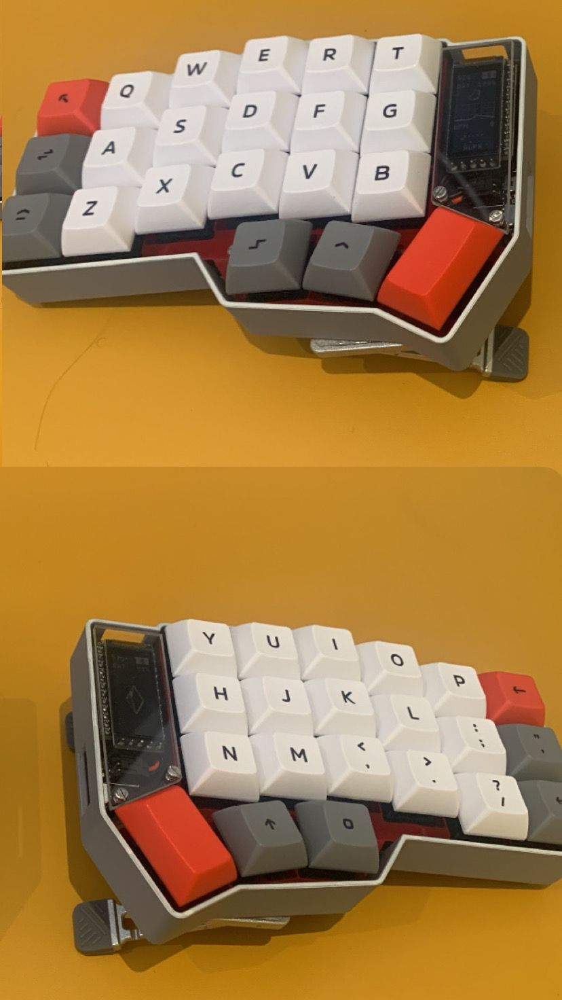

# Alphred Firmware

Firmware for the **Alphred**, a custom-built CRKBD 6-column, 42-key split keyboard. This is the second iteration of the original *Alph* firmware, which powered the first version of the build. Alphred V2 aims to improve upon the original in terms of functionality, maintainability and user experience.

The firmware is built using [ZMK](https://zmk.dev/), a modern firmware platform for wireless mechanical keyboards. For further details on syntax and configuration behavior, refer to the [ZMK documentation](https://zmk.dev/docs).

> **Why "Alphred"?**  
> This V2 build features red-colored PCBs, giving rise to the portmanteau *Alph + red* → *Alphred*. Could’ve been *Ralph* for "Red Alph", honestly. Either is good tbh.

---

## 🗂️ Repository Structure

### `config/corne.keymap`
Defines the keyboard layout, key bindings, behaviors (e.g. hold-tap, layers, macros), and other input logic for the Corne build.

#### Configuring Keymaps

Keymaps can be configured manually by modifying `corne.keymap`, but in most cases it's easier to use the [Keymap Editor](https://nickcoutsos.github.io/keymap-editor/) made by Nick Coutsos, providing it has permissions to run on your repo. 

### `config/corne.conf`
ZMK configuration file that controls lower-level keyboard behavior such as debounce timing, power management, and feature toggles.

### `build.yaml`
Specifies build targets for multiple board and hardware configurations. Examples include:

- **MCUs:** `nice_nano//zmk`, `rp2040_pro_micro`
- **Displays:** `nice_oled`, `nice_epaper`

Customize these to generate specific firmware builds for each half or hardware variant.

### `west.yaml`
Controls dependency and module management via [west](https://docs.zephyrproject.org/latest/develop/west/index.html). It pulls in the main ZMK repo, along with any plugins or shield adapters required for the Alphred firmware.

### `.github/workflows/build.yml`
GitHub Actions workflow that automatically compiles build artifacts on push or PR. Outputs firmware binaries for each configured target in `build.yaml`.

---

## 🪲 Configuring Beedly

On the right hand side peripheral, you can see the Beedly the beetle Tamagotchi.
You can configure dithering for the animation by setting:
`CONFIG_NICE_BEETLE_DITHER_BEEDLY=y` to `conf/corne.conf`

### Looking after Beedly

- **Open the menu:** hold the `BLUETOOTH` layer key and press `P`. This switches to the `BEEDLY` layer.
- **Navigate:** `UP` / `DOWN` / `ENTER` sit in the same places as the arrow keys and enter on the `ARROWS` layer. Every other key does nothing on this layer, so nothing leaks into typing.
- **Actions:** `PET`, `FEED` and `SAVE`.
- **Where:** the menu shows on the left display, over the WPM graph. Beedly himself, with his hearts, food and XP bars, lives on the right half and its display.
- **Saving:** Beedly's state is saved when you pick `SAVE`, 30 s after an action, when the keyboard goes idle, and before it sleeps.
- **Exit:** press `W` (`&to CHARWIN`) or `Q` (`&to CHARMAC`), the same keys as on the `BLUETOOTH` layer, to return to typing. Holding the `BLUETOOTH` layer key first also works.

Check out my forked [zmk-nice-beetle](https://github.com/J-Jaywalker/zmk-nice-beetle) repo for more info.

---

## 🧪 Building Locally

To build the firmware locally (make sure you have the relevant compilers first):

```bash
west build -s zmk/app -d build/left -b nice_nano//zmk -- -DSHIELD=corne_left -DZMK_CONFIG=config
```
Adjust SHIELD and BOARD as needed for your hardware and layout.

